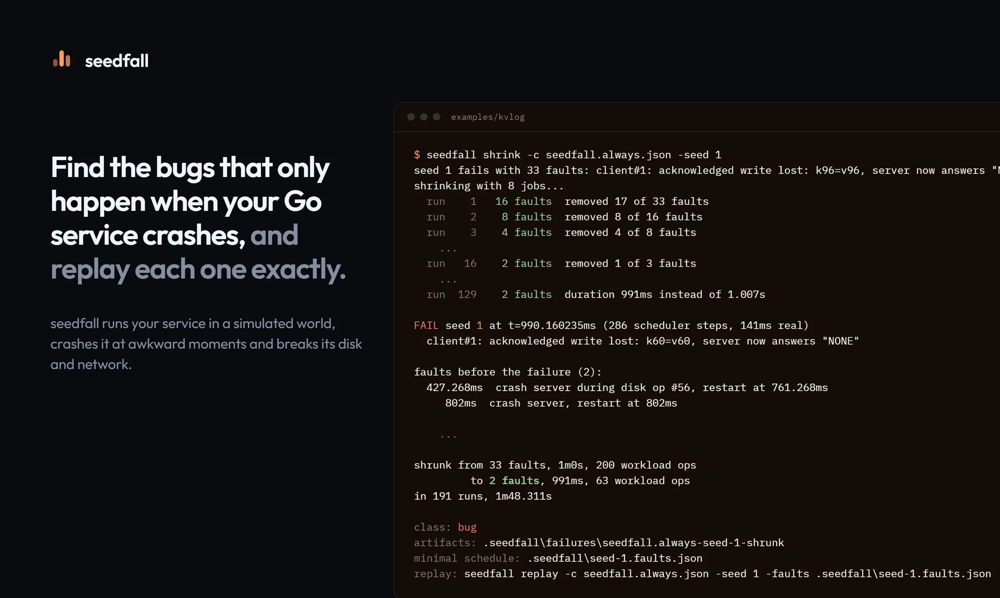

<p align="center">
  <picture>
    <source media="(prefers-color-scheme: dark)" srcset="docs/assets/logo-dark.svg">
    
  </picture>
</p>

<p align="center">
  <b>Find the bugs that only show up when your Go service crashes or the network breaks, and replay each one exactly.</b>
</p>

<p align="center">
  <a href="https://seedfall-lemon.vercel.app">Website</a> ·
  <a href="https://seedfall-lemon.vercel.app/docs/getting-started.html">Getting started</a> ·
  <a href="https://seedfall-lemon.vercel.app/docs/findings/">Bugs found</a> ·
  <a href="https://seedfall-lemon.vercel.app/docs/agents.html">AI agents (MCP)</a> ·
  <a href="https://pkg.go.dev/github.com/kunalgoesbyken/seedfall">Go reference</a>
</p>

<p align="center">
  <a href="https://github.com/kunalgoesbyken/seedfall/actions/workflows/ci.yml"></a>
  <a href="https://github.com/kunalgoesbyken/seedfall/actions/workflows/regress.yml"></a>
</p>



---

seedfall is for people who write Go services that keep data: databases, queues, caches, anything that writes to disk or talks to other nodes. Those services usually pass their tests and then lose data in production, because the bug needs a crash at one particular moment, or a network split at another. Normal tests almost never hit that moment, and when production does, you can't reproduce it.

seedfall runs your service in a simulation where it controls the clock, the disk and the network. It crashes nodes, cuts the power halfway through a write, fails disk syncs and splits the network, thousands of times with different random choices. Each run is named by a **seed**, which is just a number. If a run breaks one of your checks, the same seed gives you the same failure again, every time, on any machine. Then `seedfall shrink` cuts the failure down to the few faults that matter.

## Get started

You need Go 1.25 or newer. Linux, macOS and Windows work. Install seedfall first:

```sh
go install github.com/kunalgoesbyken/seedfall/cmd/seedfall@latest
seedfall doctor    # checks your setup and prints a fix for anything missing
```

Other install options (Homebrew, Scoop, a script, Docker) are in [install docs](https://seedfall-lemon.vercel.app/docs/install.html), but they need a release newer than v0.2.0, so use `go install` for now.

### Let your AI agent use it

Add the seedfall MCP server to the agent you use:

```sh
claude mcp add seedfall -- seedfall mcp                 # Claude Code
codex mcp add seedfall -- seedfall mcp                  # Codex
gemini mcp add seedfall seedfall mcp                    # Gemini CLI
code --add-mcp '{"name":"seedfall","type":"stdio","command":"seedfall","args":["mcp"]}'   # VS Code (Copilot)
npx skills add kunalgoesbyken/seedfall                  # the four seedfall skills, for any agent
```

Cursor, Windsurf and others: [setup for every agent](https://seedfall-lemon.vercel.app). Your agent can then set seedfall up in your repository, run the crash and network tests, shrink a failure to its cause and prove its own fix, with no API key. Agents can read every doc as Markdown from [llms.txt](https://seedfall-lemon.vercel.app/llms.txt).

### Use it yourself (2 minutes)

```sh
git clone https://github.com/kunalgoesbyken/seedfall
cd seedfall/examples/kvlog
seedfall run -c seedfall.always.json -seeds 1-100
```

`examples/kvlog` is a small key-value server that syncs to disk before it says "saved". It still loses data:

```
FAIL seed 1 at t=2.891820635s (737 scheduler steps, 445ms real)
  client#1: acknowledged write lost: k96=v96, server now answers "NONE"
```

Shrink it to the smallest failing case:

```sh
seedfall shrink -c seedfall.always.json -seed 1
```

```
faults before the failure (2):
  427.268ms  crash server during disk op #56, restart at 761.268ms
     802ms  crash server, restart at 802ms
```

Two crashes are enough. The first one interrupts a write and leaves a half-written line. After the restart the server keeps appending after that line, so the second restart can't read the record that follows it. `seedfall replay -c seedfall.always.json -seed 1` prints the full trace. The [getting started guide](https://seedfall-lemon.vercel.app/docs/getting-started.html) goes on to the fix and the proof that it holds.

## Use it on your own service

```sh
seedfall init
```

This looks at your module, lists the packages that can't build for the simulator yet and why, and writes a starter `seedfall.json` and a workload. The workload is a Go program that uses your service and checks what must stay true, for example "every write I was told succeeded is still there after a crash". Your code has to build for `GOOS=wasip1` (Go's WebAssembly target, which is what seedfall runs), so cgo is not available. Then run `seedfall run -seeds 1-1000`. The steps are in [getting started](https://seedfall-lemon.vercel.app/docs/getting-started.html#your-own-project).

## What you get

- **Real failures, not guesses.** Crashes in the middle of a write, half-written data, failed `fsync` calls (the call that forces data onto disk), full disks, network splits and clock jumps.
- **Replay from one number.** Same seed, same run, byte for byte, with a full trace and a timeline diagram of what happened.
- **Small failing cases.** `seedfall shrink` cuts a failure with dozens of faults down to the two or three that cause it.
- **Your code, mostly unchanged.** It uses the stock Go toolchain, and plain `net/http` servers and other network code can run without edits.
- **A way to prove the fix.** `seedfall verify` replays the failing case, sweeps fresh seeds and writes a summary you can paste into the pull request.
- **No service or account.** It runs on your laptop or in CI, with a GitHub Action included.

Everything else (consistency checkers, a disk inspector, a time-travel debugger, mutation testing of your own checks, triage reports) is in the [docs](https://seedfall-lemon.vercel.app/docs/).

## Bugs found

Found by running seedfall on real open-source projects. Links go to the upstream issue where there is one (status as of 2026-11-09).

- **NATS JetStream:** a crash while a stream is being created makes it vanish, with all its acknowledged messages, on the next restart. [nats-server#8872](https://github.com/nats-io/nats-server/issues/8872), open.
- **rosedblabs/wal:** after one crash mid-write, new synced writes land after the damaged chunk and are lost, and rosedb v2 can no longer open. [#51](https://github.com/rosedblabs/wal/issues/51), open.
- **tidwall/buntdb:** a crash after the automatic file shrink can bring the database back empty, even with sync set to always. [#126](https://github.com/tidwall/buntdb/issues/126), fixed in [6a23821](https://github.com/tidwall/buntdb/commit/6a23821fdfd51ab6e375b8f82407b6589cad907f).
- **tidwall/wal:** a crash mid-write makes the log permanently unopenable, and the pending fix is incomplete. [#43](https://github.com/tidwall/wal/issues/43), open.
- **hashicorp/raft:** the snapshot directory is never synced before a rename, so on a strict file system one crash leaves a node that panics on every restart. [#744](https://github.com/hashicorp/raft/issues/744), open.
- **nutsdb:** one crash can make recovery drop every acknowledged entry in a bucket, and a damaged tail makes `Open` fail forever. [#695](https://github.com/nutsdb/nutsdb/issues/695), [#696](https://github.com/nutsdb/nutsdb/issues/696), [#697](https://github.com/nutsdb/nutsdb/issues/697), open.
- **bitcask:** four problems that leave the database unopenable after one crash. No upstream link recorded.
- **diskv:** on a strict file system, an acknowledged write can revert after a crash. [#83](https://github.com/peterbourgon/diskv/issues/83), open.
- **bbolt:** on a strict file system, one crash can lose the whole database. Not filed yet.
- **jmsadair/raft:** four ways one crash or one clock step back leaves a node that can never restart. Not filed, because the repository is no longer public.

We also asked Claude for a crash-safe key-value store nine times with one prompt. Every sample's own tests passed, and seedfall found two that can refuse to open forever after a specific crash ([examples/aikv](examples/aikv)).

hashicorp/raft (600 seeds) and etcd-io/raft (100 seeds) pass cleanly. Details, replay commands and fixes are in [docs/findings](https://seedfall-lemon.vercel.app/docs/findings/).

## When it's not a fit

- **Your code must build for `GOOS=wasip1`.** Anything that needs cgo won't work. Code that uses `mmap` or file locks works for bbolt, pebble and badger and for common libraries through a built-in shim; other unix-only code needs a shim you write ([compat](https://seedfall-lemon.vercel.app/docs/compat.html)).
- **It only breaks what you check.** If your workload doesn't test a promise, seedfall can't catch it being broken. `seedfall mutate` tells you whether your checks would notice a broken disk.
- **It's not a race detector.** It samples goroutine orderings rather than trying them all, and it doesn't replace `go test -race`.
- **Only some file systems are modelled.** ext4 in ordered mode, plus an aggressive variant and an ext2/btrfs-style one. XFS and `data=journal` have no model of their own.
- **It's Go only.** Everything runs as Go compiled for `wasip1`.
- **Big programs boot slowly.** A large server like nats-server takes 0.1 to 0.3 seconds to start each node, which dominates short runs. See [speed](https://seedfall-lemon.vercel.app/docs/how-it-works.html#speed).

## Also

[Gostman](https://github.com/kunalgoesbyken/gostman) collections can be used as workloads: the API checks you already have run while seedfall crashes and splits the service behind them ([docs](https://seedfall-lemon.vercel.app/docs/gostman.html)).

The [docs index](https://seedfall-lemon.vercel.app/docs/) lists every page. If a build or run fails for a reason outside your system, start with [troubleshooting](https://seedfall-lemon.vercel.app/docs/troubleshooting.html). The [FAQ](https://seedfall-lemon.vercel.app/docs/faq.html) compares seedfall with Antithesis, gosim, `testing/synctest`, `-race` and Jepsen. See [CONTRIBUTING](CONTRIBUTING.md) and the [roadmap](ROADMAP.md), and report vulnerabilities as described in [SECURITY](SECURITY.md).

## License

Apache-2.0
