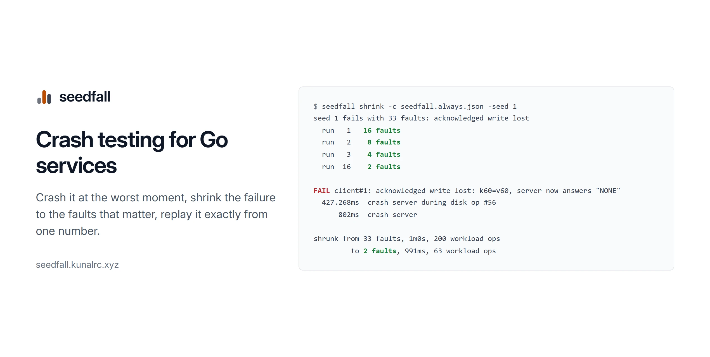

<p align="center">
  <picture>
    <source media="(prefers-color-scheme: dark)" srcset="docs/assets/logo-dark.svg">
    
  </picture>
</p>

<p align="center">
  Crash testing for Go services: break the disk and network on purpose, then replay every failure from one number.
</p>

<p align="center">
  <a href="https://seedfall.kunalrc.xyz">Website</a> ·
  <a href="https://seedfall.kunalrc.xyz/docs/getting-started.html">Getting started</a> ·
  <a href="https://seedfall.kunalrc.xyz/docs/">Docs</a> ·
  <a href="https://seedfall.kunalrc.xyz/gym">RL gym</a>
</p>

<p align="center">
  <a href="https://github.com/kunalgoesbyken/seedfall/actions/workflows/ci.yml"></a>
  <a href="https://github.com/kunalgoesbyken/seedfall/actions/workflows/regress.yml"></a>
  <a href="https://pkg.go.dev/github.com/kunalgoesbyken/seedfall"></a>
</p>

<picture>
  <source media="(prefers-color-scheme: dark)" srcset="docs/assets/readme-card-dark.webp">
  
</picture>

seedfall runs your Go service in a deterministic simulation on WebAssembly. It crashes nodes mid-write, tears and fails disk writes, and splits the network, and it names every run by a seed. The same seed gives the same run, byte for byte, on any machine, and `seedfall shrink` cuts a failure down to the few faults that cause it.

## Install

Go 1.25 or newer, on Linux, macOS or Windows:

```sh
go install github.com/kunalgoesbyken/seedfall/cmd/seedfall@latest
seedfall doctor
```

## Try it

```sh
git clone https://github.com/kunalgoesbyken/seedfall
cd seedfall/examples/kvlog
seedfall run -c seedfall.always.json -seeds 1-100
seedfall shrink -c seedfall.always.json -seed 1
```

`kvlog` syncs before it says "saved" and still loses a write: a crash leaves a torn line, the server appends after it, and the next restart can't read past it. The shrink gets 33 faults down to 2.

For your own service, `seedfall init` writes a starter config and workload. Your code has to build for `GOOS=wasip1`, so cgo is out. The [getting started guide](https://seedfall.kunalrc.xyz/docs/getting-started.html) walks through it.

## Use it from an AI agent

```sh
claude mcp add seedfall -- seedfall mcp
```

Setup for Codex, Gemini CLI, VS Code, Cursor and others is in [docs/agents](https://seedfall.kunalrc.xyz/docs/agents.html).

## Bugs found

Crash bugs in NATS JetStream (fixed), rosedblabs/wal, tidwall/buntdb (fixed), tidwall/wal, hashicorp/raft, nutsdb, diskv, bitcask, bbolt and jmsadair/raft. Each has a write-up with a replay command in [docs/findings](https://seedfall.kunalrc.xyz/docs/findings/).

## seedfall-gym

[`gym/`](gym/) holds two RL environments built on seedfall. In one, 42 tasks, an agent fixes a crash bug in Go storage code and is rewarded by hidden fault seeds. In the other, [`gym/rl`](gym/rl/), a model plans a rolling upgrade of a simulated raft cluster. Qwen3-1.7B trained on it with GRPO went from 0.06 to 0.70 on held-out scenarios (a scripted oracle gets 0.79), after an earlier run exploited a grader hole that is now fixed. See the [write-up](https://seedfall.kunalrc.xyz/gym).

## Limits

- Go only, and the code must build for `GOOS=wasip1`.
- It only catches what your workload checks.
- It samples goroutine orderings and doesn't replace `go test -race`.

## Contributing

See [CONTRIBUTING](CONTRIBUTING.md) and [SECURITY](SECURITY.md). Licensed under Apache-2.0.
