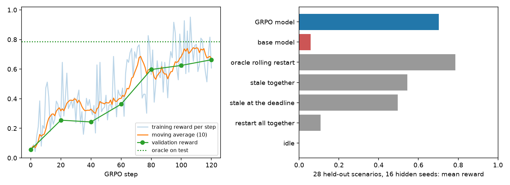

# rl: GRPO on a seedfall operator environment

A small LLM learns to write safe operator action plans for a raft cluster that seedfall simulates. The reward is the share of hidden fault seeds on which the plan, replayed deterministically, keeps the cluster available and rolls every node to the new version. Everything runs on Kaggle's free tier (one T4).

It took three runs. The second one raised the reward by finding a hole in the grader, not by learning to operate the cluster. The third, on the fixed grader, learned a real rolling restart.



## Results

Run 3, Qwen3-1.7B with LoRA, 120 GRPO steps, 5.5 hours of training. 28 held-out scenarios, 4 plans per scenario, 16 hidden seeds per plan (50001 to 50016).

| Plan | Mean reward | Every seed passes |
|---|---|---|
| base model | 0.058 | 0% |
| GRPO model (step 120, the best validation step) | 0.703 | 15% |
| scripted: oracle rolling restart | 0.786 | 21% |
| scripted: restart the stale nodes together | 0.545 | |
| scripted: restart the stale nodes at the deadline | 0.496 | |
| scripted: restart every node together | 0.107 | |
| scripted: idle, restart without `set_args` | 0 | |

Paired over the 28 scenarios with a bootstrap, the trained model scores:

- +0.645 over the base model (95% CI 0.574 to 0.713, better on 28 of 28),
- +0.158 over restarting the stale nodes together (CI 0.075 to 0.244),
- +0.207 over restarting them at the deadline (CI 0.124 to 0.291),
- 0.083 below the oracle (CI 0.043 to 0.125 below).

The base number is low mostly because 41% of the base model's plans break a rule in the prompt (an action before 1s, wrong node arguments) and score 0, and 39% of its plans touch a node that is already up to date. The scripted rows are the fairer bar.

What the trained model writes: 110 of 112 test plans replay (2 are malformed JSON), none touches an up-to-date node, every one restarts the stale nodes one at a time with the shortest allowed downtime (250ms), and none restarts a node within 1s of the deadline. The first restart is always at 1000ms, the earliest the prompt allows, and the gaps are 500 to 1500ms. That is where it loses to the oracle, which starts at 1500ms with gaps of at least 1s: of the 486 distinct failure reasons across the test plans, 241 are the SLO in the first measured window, the one the 1000ms restart falls in.

## Three runs

**Run 1** (100 steps, 4 prompts of 8 plans per step, 4 training seeds, 8 test seeds, no validation split). The test reward went from 0.361 to 0.585, but the share of plans that passed every seed fell from 10% to 0, and 80 of 224 trained plans restarted a node within 1s of the deadline. With no held-out checkpoint selection, no scripted baselines on the same seeds and only 8 seeds, it wasn't clear what had been learned.

**Run 2** (200 steps, 3 prompts of 12 plans, 8 training seeds, 16 test seeds, a validation split with best-step selection, a KL term, an adaptive entropy bonus, and a penalty that halves the reward for touching an up-to-date node). The test reward went from 0.545 to 0.682 at the best step (paired +0.137, CI 0.051 to 0.225). Then I read the plans: all 112 best-step plans restarted the stale nodes together at exactly the deadline. The workload client measured availability in 1s windows only until the deadline, then checked the versions with nobody measuring. An outage that started at the deadline was free. The base model's replay rate was already 0.85: 104 of its 112 plans restarted near the deadline too. The model had found the hole and amplified it. The results are kept in `results/run2/`.

**Fixes**, all in `etcdraft/opclient`, `rlenv/` and seedfall's public `examples/etcdraft`:

- the clients keep measuring through a grace period after the deadline while the versions are polled, so a restart at the deadline costs availability like any other,
- a window with no operations at all fails instead of being skipped,
- the first window is unmeasured while the cluster starts, so no action may come before 1000ms (an action at 0ms used to hide its outage there),
- `set_args` must give exactly the node's arguments for the target version,
- durations must match `[0-9]+(\.[0-9]+)?(ms|s)` (Python's `\d` accepted other scripts' digits),
- the version poll is bounded by the grace period.

The scenario family was regenerated against the fixed grader and the oracle was moved to start at 1500ms, since its old 500ms start had relied on the unmeasured first window.

**Run 3** (120 steps, the run 2 settings). The results are above. It also checks that the remaining known limit isn't what was learned: restarting at the deadline still passes about half the seeds on the fixed grader (the SLO is loose enough), and the model doesn't do it.

## The task

One prompt, one answer. The prompt describes a raft key-value cluster (3 or 5 etcd-io/raft nodes), the version each node runs now, the target version, the deadline, the availability SLO, the allowed restart downtime and the fault rates. The model answers with a JSON array of operator actions (`set_args`, `restart`). `seedfall env` replays the plan on K seeds the model never sees (`reset` on the first seed plus `verify` with the rest), and the reward is the fraction of seeds that pass. A seed passes when:

- every node reports the target version by the deadline (only `set_args` followed by a restart changes it),
- at least `slo` of the clients' operations succeed in every 1s window after the first, until 2s after the deadline, and no window is empty,
- the history stays linearizable.

A plan scores 0 without a replay if it doesn't parse or breaks the schema: an unknown kind or node, an action before 1000ms or after the deadline, a malformed duration, a restart downtime outside the allowed range, `set_args` arguments that aren't exactly the node's arguments for the target version, or more than 24 actions. Touching a node that already runs the target version halves the reward. There is no format bonus.

## Scenario family

`rlenv/scenarios.py` samples a scenario from: node count (3 with 70%, 5 with 30%), target version 2 to 4, which nodes are stale and on which older version, deadline (5 to 7s for 3 nodes, 7 to 9s for 5), restart downtime (250ms up to 400, 600 or 800ms), SLO 50, 60 or 70%, and crash and partition rates per node (0.01, 0.03 or 0.06 a second). 64 train and 32 test configs are sampled with no parameter tuple shared between the splits, then `make_scenarios.py` keeps a config only if:

- the scripted rolling-restart oracle passes at least 4 of 6 filter seeds,
- the idle plan fails on all of them.

77 of 96 survive (49 train, 28 test). Training holds 9 of the 49 out for validation. `scenarios.json` holds them with the filter results (the run 1 and run 2 set is `results/run2/scenarios.json`). Seeds are split too: filter seeds 90001 to 90006, training seeds drawn at random from 1000 to 49999 (new seeds per prompt per step, the same seeds for all plans of one prompt), test seeds 50001 to 50016.

`etcdraft/` is a copy of seedfall's `examples/etcdraft` with two additions. The node takes `-n` (cluster size), so a 5 node cluster needs no peer list, and the client takes `-pace`, so episodes are cheaper (2 clients at a 40ms pace instead of 3 at 10ms).

## Reward cost and caching

An episode is 5 to 9s of virtual time plus the grace period. `rlenv/reward.py` keeps a few long-lived `seedfall env -j 2` processes. Within a reward call, identical (scenario, plan, seeds) triples run once. A plan that never sets the version argument of some stale node can't pass, so it scores 0 without a replay. The model evaluations use this shortcut, the scripted baselines don't, so idle and restart-without-`set_args` are really replayed. `tests/test_reward.py` checks the shortcut against a replay. Run 3 replayed 8576 episodes in training with no environment failures.

## Files

| Path | What |
|---|---|
| `rlenv/scenarios.py` | scenario sampler, config writer, scripted plans |
| `rlenv/prompt.py` | the prompt |
| `rlenv/reward.py` | parse, validate, replay through `seedfall env`, cache |
| `rlenv/env.py` | the JSON-lines client for `seedfall env` |
| `make_scenarios.py` | draws and filters the scenario family |
| `train.py` | base eval, GRPO with validation, test eval of the best and final steps, scripted baselines |
| `plot.py` | the figure above |
| `build_tree.sh`, `kaggle/package.sh` | assemble the seedfall tree plus `etcdraft/` and the code into the private dataset |
| `kaggle/kernel_main.py`, `kaggle/kernel-metadata.json` | the GPU kernel (run 3 arguments) |
| `tests/test_reward.py` | reward unit tests |
| `results/run1`, `run2`, `run3` | what the kernels returned, minus the adapters |

## Commands

From `gym/rl/`:

```sh
./build_tree.sh _work/tree
(cd _work/tree && go build -o ../seedfall ./cmd/seedfall)
SEEDFALL_BIN=$PWD/_work/seedfall SEEDFALL_TREE=$PWD/_work/tree python tests/test_reward.py

python make_scenarios.py --tree _work/tree --binary _work/seedfall --out scenarios.json

./kaggle/package.sh scenarios.json _work/pkg
kaggle datasets version -p _work/pkg -m "update"
kaggle kernels push -p kaggle
kaggle kernels output krockxz/seedfall-rl-grpo -p results/run3

python train.py --tree _work/tree --scenarios scenarios.json --work _work/w --out _work/baselines --baselines-only
python plot.py results/run3 results/run3/reward_curve.png
```
